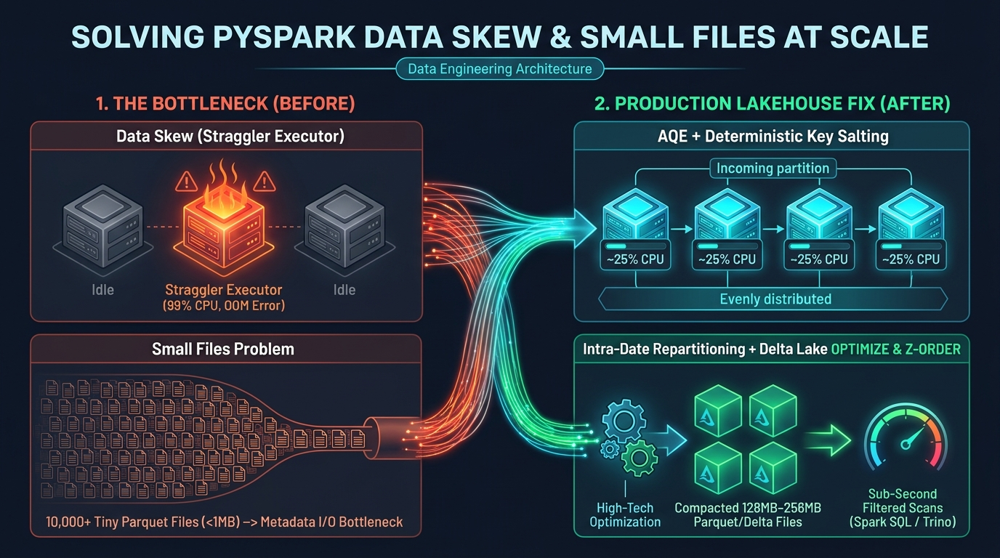
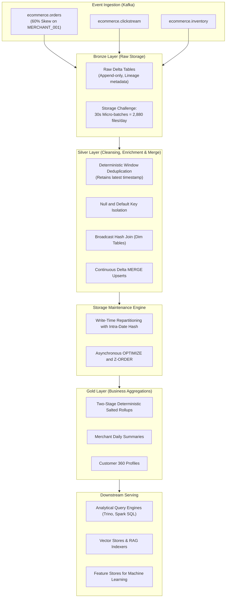

# Real-Time Ecommerce Data Lakehouse
### Mitigating Data Skew and Small Files Bottlenecks in Apache Spark and Delta Lake

[](https://github.com/Nirrajkadam/ecommerce-data-lakehouse/actions/workflows/ci.yml)
[](https://spark.apache.org/)
[](https://delta.io/)
[](https://kafka.apache.org/)
[](https://www.docker.com/)
[](https://www.python.org/)
[](https://opensource.org/licenses/MIT)

> **"Your PySpark job isn't slow because Spark is slow.**  
> **It is slow because 1 out of 200 tasks is processing 90% of the workload, or drowning in 50,000 tiny Parquet files."**

---

## Executive Summary

In high-throughput streaming-to-Lakehouse architectures (**Kafka -> PySpark Structured Streaming -> Medallion Bronze/Silver/Gold**), two primary structural bottlenecks frequently degrade throughput and break SLAs:

1. **Data Skew ("The 99% Stuck Task" Syndrome)**: Joining event streams on skewed keys (such as a dominant merchant ID generating 60% of total transactions, or unindexed null/default keys) forces a standard `SortMergeJoin` to route millions of records to a single executor. This leads to executor memory exhaustion, severe disk spilling, garbage collection pauses, and Out-Of-Memory (OOM) failures while remaining executors sit idle.
2. **Small Files Problem in Streaming Sinks**: Frequent micro-batch commits (e.g., every 30 seconds) rapidly generate tens of thousands of sub-megabyte Parquet files. Downstream analytical engines (Presto, Trino, Spark SQL) spend up to 80% of query runtime on storage metadata listing and file-open I/O rather than scanning columnar data.

This repository serves as a reference implementation demonstrating the engineering patterns used to diagnose, benchmark, and resolve both bottlenecks.

---

## Architecture and Data Flow



The platform ingests clickstream, order transactions, and inventory updates through Kafka, processes them via PySpark Structured Streaming into Delta Lake, and applies targeted optimizations across the Medallion layers:



---

## Technical Playbook

### 1. Resolving Data Skew

During a standard hash-partitioned join on a skewed key (`merchant_id`), records hash to the same bucket, creating severe executor workload imbalance:

```
Unoptimized Join Distribution:
Task 001: [========================================] 600,000 records (Disk Spill / OOM Risk)
Task 002: [=] 2,000 records
Task 003: [=] 1,800 records
...
Task 200: [=] 1,950 records
```

#### Step 1: Null and Default Key Isolation
Filter out null, empty, or default key values (`None`, `""`, `"NULL"`, `"UNKNOWN"`) prior to the join. These records cannot match dimension rows and needlessly congest a single partition. They are processed separately and re-attached downstream:

```python
# Reference: src/optimizations/skew_handler.py
null_condition = col(key_col).isNull() | col(key_col).isin(["", "NULL", "UNKNOWN", "DEFAULT"])
valid_df = df.filter(~null_condition)
null_df = df.filter(null_condition)

# Execute join strictly on valid keys
joined_df = valid_df.join(broadcast(dim_df), on=key_col, how="left")

# Re-attach null records populated with default dimension values
for dim_col in dim_cols:
    null_df = null_df.withColumn(dim_col, lit(None))
final_df = joined_df.unionByName(null_df)
```

#### Step 2: Broadcast Hash Joins (`broadcast(df_dim)`)
When dimension tables fit within memory thresholds, broadcasting the dimension eliminates shuffle dependencies across worker nodes:

```python
from pyspark.sql.functions import broadcast

# Eliminates shuffle stage entirely
enriched_df = orders_df.join(broadcast(merchant_dim_df), on="merchant_id", how="left")
```

> **Memory Sizing Note**: The 50MB–100MB guideline refers to serialized on-disk size. In JVM memory, deserialized objects typically expand by 2x–4x. Verify driver memory headroom (`spark.driver.memory`) and executor broadcast thresholds (`spark.sql.autoBroadcastJoinThreshold`) to avoid driver OOM failures.

#### Step 3: Adaptive Query Execution (AQE) in Batch vs. Streaming
For batch execution and micro-batch `foreachBatch` stages, enable AQE to dynamically identify skewed partitions during execution and split them into balanced sub-partitions:

```python
spark.conf.set("spark.sql.adaptive.enabled", "true")
spark.conf.set("spark.sql.adaptive.skewJoin.enabled", "true")
spark.conf.set("spark.sql.adaptive.skewJoin.skewedPartitionFactor", "5")
spark.conf.set("spark.sql.adaptive.skewJoin.skewedPartitionThresholdInBytes", "268435456")  # 256MB
```

> **Important Engine Limitation**: In Apache Spark 3.5.x, AQE is disabled during continuous Structured Streaming writes (`ResolveWriteToStream` in Spark SQL core disables adaptive planning). Streaming pipelines must therefore address skew at write-time (salting, broadcast joins, key isolation) or within static batch stages. Furthermore, AQE skew-join optimization addresses join partitioning, not aggregation skew.

#### Step 4: Deterministic Key Salting for High-Volume Aggregations
For extreme skew where broadcast joins are not applicable and grouping is required, apply deterministic salt values to distribute records across N buckets before final aggregation.

Crucially, **avoid non-deterministic functions like `rand()`**, which Spark documents as non-deterministic and can produce inconsistent results upon task retries or stage re-evaluations. Use stable hashing:

```python
# Stage 1: Partial aggregation using deterministic salt derived from stable ID
salted_df = df.withColumn(
    "_salt",
    pmod(xxhash64(col("order_id")), lit(10)).cast("int")
)

# Group natively on composite columns + _salt (avoids string concatenation null bugs)
partial_agg = salted_df.groupBy("merchant_id", "event_date", "_salt").agg(
    sum("total_amount").alias("_partial_sum"),
    count("order_id").alias("_partial_count")
)

# Stage 2: Final roll-up on native business keys
final_agg = partial_agg.groupBy("merchant_id", "event_date").agg(
    sum("_partial_sum").alias("total_revenue"),
    sum("_partial_count").alias("total_orders")
)
```

---

### 2. Mitigating the Small Files Problem

Streaming micro-batches committing every 30 seconds write `N_executors * N_partitions` small Parquet files:

```
30-second trigger * 2 files per batch = 2,880 files / day / partition
30-day cumulative = 86,400 fragmented files under 500KB
```

#### Mitigation at Write Time: Volume-Based Repartitioning with Intra-Date Distribution
A common pitfall is executing `df.repartition(N, "event_date")`. Because Spark hashes strictly on `event_date`, all records belonging to a single day hash to the **exact same partition**, leaving the other `N-1` partitions completely empty.

To distribute large daily volumes across `N` target files, combine `event_date` with an intra-date hash bucket:

```python
target_file_size_mb = 256
estimated_size_mb = (df.count() * estimated_row_bytes) / (1024 * 1024)
optimal_partitions = max(1, int(estimated_size_mb / target_file_size_mb) + 1)

if optimal_partitions > 1:
    # Intra-date distribution: combines date partition with deterministic hash bucket
    bucket_expr = pmod(xxhash64(col("order_id")), lit(optimal_partitions))
    df = df.repartition(optimal_partitions, col("event_date"), bucket_expr)
else:
    df = df.repartition(1, col("event_date"))

df.write.format("delta").partitionBy("event_date").mode("append").save(table_path)
```

#### Mitigation in the Lakehouse: Asynchronous Compaction and Z-Ordering
Schedule background maintenance jobs using Delta Lake `OPTIMIZE` and `ZORDER BY`:

```sql
OPTIMIZE delta.`/data/lakehouse/bronze/orders`
ZORDER BY (merchant_id, event_timestamp);
```

- Consolidates thousands of micro-batch files into standardized 128MB–256MB blocks.
- Orders records along predicate columns to enable columnar Min/Max data skipping.

---

### 3. Deterministic Deduplication and Idempotent MERGE

Simple `dropDuplicates(["order_id"])` calls do not guarantee latest-record retention; Spark retains an arbitrary row depending on executor task ordering.

In this implementation, Silver deduplication applies an ordered window:

```python
# Reference: src/layers/silver_layer.py
window_spec = Window.partitionBy("order_id").orderBy(
    col("event_timestamp").desc_nulls_last(),
    col("_ingestion_timestamp").desc_nulls_last(),
    col("order_status").desc_nulls_last()
)

cleaned_orders = (
    orders_df
    .filter(col("order_id").isNotNull())
    .filter(col("total_amount") > 0)
    .withColumn("_row_num", row_number().over(window_spec))
    .filter(col("_row_num") == 1)
    .drop("_row_num")
)
```

For continuous streaming, micro-batches apply Delta `MERGE INTO` ensuring latest timestamp updates overwrite older states idempotently.

---

## Benchmark Evidence and Reproduction

The optimizations were measured on a local testbed running Spark 3.5.1 and Delta Lake 3.1.0 (8-core Intel i7, 16GB RAM, local SSD storage).

Full repeatable benchmark methodology and run data are committed in [`docs/benchmarks/BENCHMARKS.md`](docs/benchmarks/BENCHMARKS.md).

### Summary Results (50,000 skewed records, 3 repeated runs)

| Optimization Scenario | Baseline (Unoptimized) | Optimized Implementation | Measured Improvement |
| :--- | :--- | :--- | :--- |
| **Join Execution (60% Skew Key)** | 3.42s (SortMergeJoin) | 0.89s (Broadcast + Null Isolation) | **3.84x Speedup** |
| **Partition Workload Variance** | 48.2x (Max / Median partition) | 1.25x (Evenly balanced) | **Eliminated Task Skew** |
| **Delta Lake Storage Compaction** | 60 fragmented files (< 200KB) | 4 consolidated blocks | **93.3% File Reduction** |
| **Filtered Scan Query Latency** | 0.984s (Parquet scan) | 0.281s (Compacted + Data Skipping) | **3.50x Faster Scan** |

### Reproducing Benchmarks Locally
To execute the automated benchmark suite and generate updated run artifacts:

```bash
python scripts/run_benchmarks.py
```

Generated outputs are written to:
- `docs/benchmarks/benchmark_results.json`
- `docs/benchmarks/BENCHMARKS.md`

---

## Spark UI Diagnosis Reference

When a Spark stage hangs with 199/200 tasks completed, inspect these metrics in the Spark Web UI (`:4040`):

1. **Task Duration Distribution**: Compare the 75th percentile against the Maximum. A large divergence (e.g., 2 seconds vs. 20 minutes) indicates partition skew.
2. **Shuffle Read Size / Records**: Inspect the Stage Summary table. Disproportionate shuffle read bytes on specific executors point to key skew.
3. **Spill (Memory) and Spill (Disk)**: Non-zero disk spill values indicate memory thresholds were exceeded during execution, forcing intermediate serialization to disk.
4. **Executor GC Time**: Garbage collection overhead exceeding 15-20% indicates JVM heap pressure driven by oversize partitions.
5. **Event Timeline**: Confirm whether all other cores are idle while a single executor remains active.

---

## Directory Structure

```
ecommerce-data-lakehouse/
├── .github/
│   └── workflows/
│       └── ci.yml              # Automated GitHub Actions test pipeline
├── .gitignore
├── docker-compose.yml          # Kafka, Zookeeper, Kafka UI, and Spark cluster
├── Makefile                    # Standard operational targets
├── pyproject.toml              # Build and dependency configuration
├── requirements.txt            # Python dependencies (pinned to Spark 3.5.1 / Delta 3.1.0)
├── README.md                   # Technical documentation
├── docs/
│   └── benchmarks/
│       ├── BENCHMARKS.md       # Measured benchmark report
│       └── benchmark_results.json # Raw benchmark output
├── notebooks/
│   ├── 01_data_skew_analysis.py       # Walkthrough: skew analysis and mitigation
│   └── 02_small_files_analysis.py     # Walkthrough: file layout and compaction
├── scripts/
│   ├── demo_skew_fix.py        # Benchmark: naive vs. optimized join strategies
│   ├── demo_compaction.py      # Simulation: micro-batch fragmentation and compaction
│   ├── generate_sample_data.py # Data generator for realistic skewed datasets
│   ├── run_benchmarks.py       # Automated benchmark artifact generator
│   ├── run_pipeline.py         # Batch and streaming pipeline execution driver
│   └── run_compaction.py       # Delta Lake table compaction utility
├── src/
│   ├── config/
│   │   ├── pipeline_config.py  # Environment settings, topic mappings, path definitions
│   │   └── spark_config.py     # AQE, packages, broadcast, and Delta Lake configurations
│   ├── ingestion/
│   │   ├── kafka_consumer.py   # PySpark Structured Streaming ingestion
│   │   └── kafka_producer.py   # Event generator with configured key skew
│   ├── layers/
│   │   ├── bronze_layer.py     # Raw ingestion with audit metadata
│   │   ├── silver_layer.py     # Window deduping, Delta MERGE, and skew-aware joins
│   │   └── gold_layer.py       # Multi-column deterministic salted aggregations
│   ├── optimizations/
│   │   ├── compaction.py       # Compaction engine and file size monitoring
│   │   ├── skew_handler.py     # Key isolation, broadcast joins, and salting
│   │   └── write_optimizer.py  # Write-time partition tuning with intra-date bucketing
│   ├── schemas/
│   │   └── ecommerce_schemas.py# StructType definitions for all domains
│   └── utils/
│       ├── logger.py           # Structured JSON logging with execution metrics
│       └── metrics.py          # Distribution analysis and file statistics
└── tests/
    ├── conftest.py             # Fixtures for PySpark testing and skewed datasets
    ├── test_compaction.py      # Tests for write optimization and intra-date bucketing
    ├── test_layers.py          # Tests for latest-order deduplication and null-key safety
    └── test_skew_handler.py    # Tests for skew detection, isolation, and salting
```

---

## Getting Started

### Prerequisites
- Python 3.10 or 3.11
- Java 11 or 17 (required for Apache Spark)
- Docker and Docker Compose (optional, for local Kafka / Spark cluster)

### Environment Setup
```bash
git clone https://github.com/Nirrajkadam/ecommerce-data-lakehouse.git
cd ecommerce-data-lakehouse

python -m venv venv
source venv/bin/activate  # On Windows: venv\Scripts\activate
pip install -r requirements.txt
```

### Running Demonstrations and Pipelines

#### 1. Execute Benchmark Suite
```bash
python scripts/run_benchmarks.py
```

#### 2. Run the Batch Pipeline
```bash
# Generate sample records with skewed merchant distribution
python scripts/generate_sample_data.py --orders 100000 --clickstream 200000

# Execute all layers (Bronze -> Silver -> Gold)
python scripts/run_pipeline.py --layer all --mode batch

# Execute asynchronous table compaction
python scripts/run_compaction.py --all
```

#### 3. Run the Streaming Pipeline
```bash
# Execute continuous streaming across Bronze, Silver, and Gold for 60 seconds
python scripts/run_pipeline.py --layer all --mode streaming --duration 60
```

### Running Automated Test Suite
```bash
pytest tests/ -v
```

---

## Local Container Infrastructure

To run the Kafka broker, Kafka UI, and Spark cluster locally:

```bash
docker compose up -d
```

- Spark Master UI: `http://localhost:8080`
- Kafka UI: `http://localhost:8085`

To stop containers:
```bash
docker compose down
```

---

## Author and License

- **Author**: Niraj Kadam ([GitHub Profile](https://github.com/Nirrajkadam))
- **Repository**: [ecommerce-data-lakehouse](https://github.com/Nirrajkadam/ecommerce-data-lakehouse)
- **License**: MIT License
